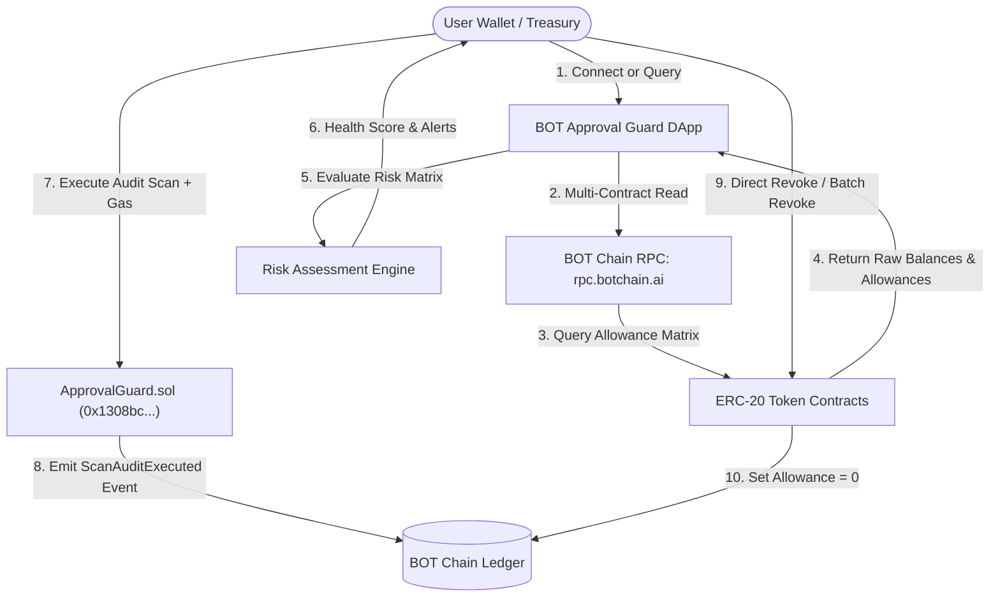

# BOT Approval Guard Whitepaper
### Autonomous Smart-Contract Security, Gas-Metered Allowance Auditing & Decentralized Risk Defense on BOT Chain
**Version:** 1.0.0 | **Network:** BOT Chain Mainnet (Chain ID: `677`)  
**Core Registry Contract:** [`0x1308bcc49fd9e4ef533c0915e6cb3a0a0d16cbf5`](https://scan.botchain.ai/address/0x1308bcc49fd9e4ef533c0915e6cb3a0a0d16cbf5)  
**Native Currency:** BOT (18 decimals, 150M Total Fixed Supply)  
**RPC Endpoint:** `https://rpc.botchain.ai` | **Website:** `https://botchain.ai` | **Explorer:** `https://scan.botchain.ai`

---

## 1. Executive Summary

Decentralized finance (DeFi) protocols rely ubiquitously on the ERC-20 token standard. To allow decentralized exchanges (DEXs), lending markets, and staking pools to move funds on behalf of a user, users sign an `approve(address spender, uint256 amount)` transaction. Due to gas optimization patterns and friction reduction in early DeFi UX, decentralized applications standardized requesting **infinite/unlimited token allowances** (`type(uint256).max` or $2^{256}-1$).

While convenient, unlimited approvals create persistent, dormant attack surfaces. If an approved spender contract contains a logic bug, is upgraded by an attacker, or suffers a private key compromise, **all wallets with outstanding allowances can be drained instantly without any further user interaction**.

**BOT Approval Guard** is an institutional-grade, non-custodial smart-contract security protocol and real-time allowance watchdog engineered natively for **BOT Chain (Chain ID: 677)**. It empowers users and protocol treasuries to:
1. Conduct real-time, gas-metered audits recorded immutably on-chain.
2. Detect and score infinite allowances and unverified contract spenders.
3. Execute instantaneous single-click and batch revocations via direct `approve(spender, 0)` calls.
4. Establish decentralized allowance thresholds and trusted spender lists on `ApprovalGuard.sol`.

---

## 2. Threat Modeling & Problem Statement

### 2.1 The Infinite Allowance Dilemma
Under the ERC-20 specification:
$$\text{allowance}(owner, spender) \ge \text{transferAmount}$$

When a user approves $1.1579 \times 10^{77}$ units (`type(uint256).max`), the spender retains permanent, irrevocable authorization to transfer any balance the owner holds in that token until manually cleared.

### 2.2 Attack Vectors Addressed
* **Dormant Spender Exploitation:** Protocol contracts deployed years prior that retain permissions long after the user ceased using the dApp.
* **Malicious Upgrades & Proxy Takeovers:** Exploits where an upgradeable proxy smart contract's implementation is compromised.
* **Phishing & Unverified Spenders:** Rogue contracts tricking users into signing unlimited approvals disguised as airdrop claims or NFT mints.
* **Re-entrancy & Logic Flaws in Routers:** Flaws within router logic permitting unauthorized invocations of `transferFrom`.

---

## 3. Protocol Architecture

BOT Approval Guard operates through a hybrid architecture combining a high-speed decentralized client watchdog with the on-chain immutable registry `ApprovalGuard.sol`.



### 3.1 Smart Contract: `ApprovalGuard.sol`
Deployed on BOT Chain Mainnet at:
`0x1308bcc49fd9e4ef533c0915e6cb3a0a0d16cbf5` (Block `27700125`).

#### Core Storage and State:
* `scanFee`: Dynamic protocol security fee (currently $0.0001\text{ BOT}$).
* `userRules`: Mapping of `(address user => mapping(address token => MonitoringRule))`.
* `trustedSpenders`: On-chain registry of verified and community-audited spender contracts.
* `userAudits`: Immutable log of execution timestamps, block numbers, and audit sequence IDs.

#### Key Functions:
1. `executeAuditScan(address targetWallet) external payable`
   * Validates `msg.value >= scanFee`.
   * Increments audit sequence counter for `targetWallet`.
   * Records audit timestamp and block number.
   * Emits `ScanAuditExecuted(targetWallet, msg.sender, auditCount, block.timestamp)`.
2. `configureTokenRule(address token, uint256 maxAllowanceLimit, bool isMonitored) external`
   * Enables users to define personal on-chain caps. Any off-chain watchdog detecting allowances exceeding this rule flags an elevated state.
3. `setSpenderTrust(address spender, bool isTrusted, string calldata protocolName) external`
   * Registers protocol metadata and trust status directly on the ledger.

---

## 4. Quantitative Risk Scoring Matrix

BOT Approval Guard employs a quantitative risk evaluation algorithm that translates raw allowance data into an intuitive **Wallet Guard Score** ($0 - 100\%$):

$$S_{\text{guard}} = \max\left(10, 100 - \left(30 \cdot N_{\text{critical}} + 15 \cdot N_{\text{unlimited}} + 10 \cdot N_{\text{unverified}}\right)\right)$$

Where:
* $N_{\text{critical}}$: Number of permissions combining **Unlimited Allowance** with an **Unverified Contract**.
* $N_{\text{unlimited}}$: Number of infinite permissions granted to verified protocols.
* $N_{\text{unverified}}$: Number of permissions granted to unverified contracts with finite caps.

### Risk Classification Tiers:
| Tier | Score Range | Criteria | Recommended Action |
| :--- | :--- | :--- | :--- |
| **Fortified (Safe)** | $80\% - 100\%$ | Zero unlimited unverified permissions; minimal exposure. | Routine periodic monitoring. |
| **Moderate Risk** | $50\% - 79\%$ | Multiple unlimited allowances granted to established DEXs. | Adjust allowances to custom spending caps. |
| **Severe (Critical)** | $< 50\%$ | Unlimited allowance active on unverified or high-risk contracts. | Immediate 1-Click Revocation. |

---

## 5. Revocation & Allowance Modification Mechanics

### 5.1 Individual 1-Click Revocation
Revoking an approval does not route through intermediaries. The DApp generates a direct transaction signed by the user's wallet:
```solidity
IERC20(tokenAddress).approve(spenderAddress, 0);
```
Upon confirmation, the spender's permission is set to exactly `0`, mitigating all exposure.

### 5.2 Sequential Batch Revocation
Due to EVM nonce ordering, batch revocations are queued sequentially with real-time UI progression tracking. Each step emits a distinct cryptographic transaction receipt on BOT Chain (`scan.botchain.ai`), preventing transaction collisions.

### 5.3 Custom Allowance Capping
Rather than revoking permissions entirely (which requires re-approving before every trade), users can set precise custom caps (e.g., $50\text{ USDT}$):
```solidity
IERC20(tokenAddress).approve(spenderAddress, customAmountInWei);
```

---

## 6. Gas Economics & Protocol Sustainability

BOT Approval Guard operates on the high-throughput, low-fee BOT Chain infrastructure:
* **Native Token:** BOT (18 decimals, 150,000,000 maximum supply).
* **Average Block Time:** ~3 seconds.
* **Scan Fee:** 0.0001 BOT per gas-metered audit execution.
* **Treasury Sustainability:** Scan fees accrue to the `ApprovalGuard.sol` contract to incentivize automated watchdog relayer nodes and ecosystem bug bounties.

---

## 7. Security & Non-Custodial Invariants

1. **Zero Asset Custody:** BOT Approval Guard never receives, holds, or proxies user ERC-20 tokens or native BOT.
2. **Permissionless & Trustless:** Anyone can audit any wallet address public on BOT Chain without authentication.
3. **Verified Smart Contract:** The contract source code is verified on the BOT Scan explorer API and completely open-source.

---

## 8. Roadmap

* **Phase 1 (Completed):** Protocol deployment on BOT Chain Mainnet (Chain ID: 677), live Allowance Scanner, Gas-Metered Audit Scans, Batch Revocations, and ApprovalGuard.sol Registry.
* **Phase 2 (Q4 2026):** Automated Watchdog Webhooks & Telegram/Discord alert bots integrated with BOT Chain RPC event subscriptions.
* **Phase 3 (Q1 2027):** Cross-Chain Guardian Expansion with BOT Bridge monitoring and automated emergency flash-revoke triggers.

---

*© 2026 BOT Approval Guard Core Contributors. Released under MIT Open-Source License.*
